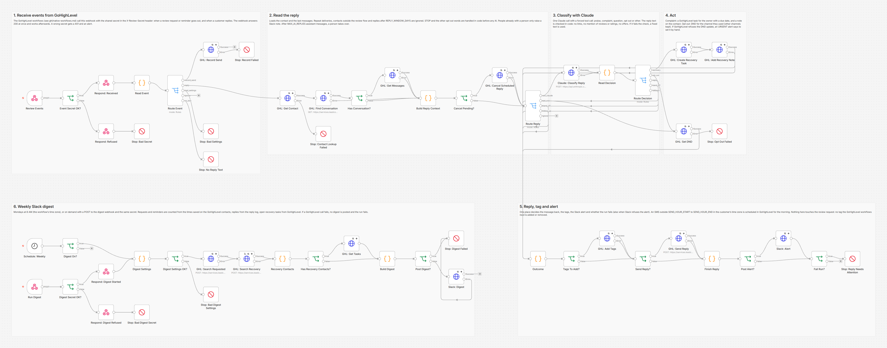
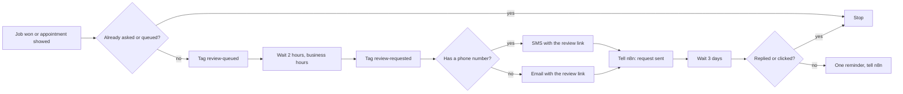
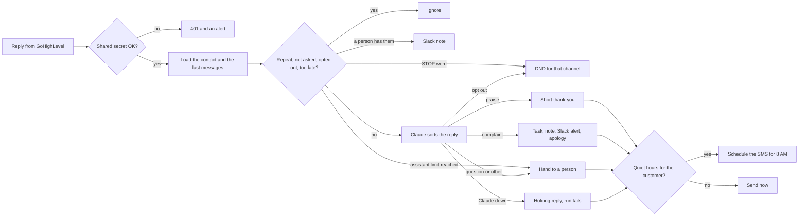

# GoHighLevel Review Requests and Service Recovery: Claude + n8n

Asks every customer of a local business for a Google review after the job, reminds them once, and lets Claude read the replies: happy customers get a short thank-you, unhappy ones get an apology and an owner who knows to call them. The GoHighLevel side runs as native workflows; the AI and the integrations run in n8n. Built for a made-up roofing company, Summit Roofing Co.



## The problem

Local service businesses live on Google reviews, but asking for them is the step that gets skipped. The crew finishes, the invoice goes out, and nobody texts the customer. When someone does ask, the replies land in an inbox nobody watches: a customer who writes "the crew left nails all over my driveway" hears nothing for days, and the owner finds out from a one-star review.

The common fix makes it worse. Many review tools ask "were you happy?" first and only send the Google link to people who say yes. That is review gating, and Google and the FTC both treat it as a problem (see [Every customer gets the same request](#every-customer-gets-the-same-request)).

## What this does

1. **Asks every customer, the same way.** When a job is marked Won in the pipeline, or an appointment is marked Showed, a GoHighLevel workflow waits 2 hours inside business hours and texts the review link (email if the contact has no phone number). Every customer gets the same words with the same link, and a second start for the same customer (a won job and a showed appointment on the same day) stops at a guard.
2. **Reminds once, never more.** Three days later, customers who neither replied nor clicked the link get one reminder. Any reply by text or email, happy or not, ends the reminder for that customer, and nothing a customer writes can stop the request itself.
3. **Sends the replies to n8n.** A second GoHighLevel workflow tags every reply and forwards it to n8n with a shared secret.
4. **Honors STOP first.** STOP, UNSUBSCRIBE and the other opt out words set DND for the channel the customer used, in code, before any AI (for SMS and email both when the channel cannot be told). That works at any time, also months later.
5. **Lets Claude read the reply.** Claude sorts it into praise, complaint, question, opt out or other through a forced tool call, so the answer always comes back as clean JSON.
6. **Thanks happy customers, without pressure.** A short thank-you. It never repeats the link and never mentions the review again.
7. **Starts service recovery for unhappy ones.** The owner gets a Slack alert with the issue in one line, a GoHighLevel task with a due date and a note on the contact. The customer gets an apology saying a person will call. The review request they already have is left exactly as it is.
8. **Hands questions to a person.** Questions and unclear replies get a short holding reply, a `needs-human` tag and a Slack alert.
9. **Checks every reply text in code.** If Claude's text contains a link, mentions reviews, ratings, stars, posting, Google or feedback, asks to hold off, change or remove anything, or offers money, a discount or anything free, it is replaced by a fixed text before anything is sent. The customer's words cannot close the tags they sit in.
10. **Respects quiet hours and a limit.** An SMS reply that would arrive outside 8 AM to 8 PM in the customer's time zone (checked again after Claude answers) is scheduled in GoHighLevel for the morning, and cancelled if they opt out, or write something that may ask us to stop, before then. After 2 assistant messages to the same customer, a person takes over.
11. **Posts a weekly digest to Slack.** Requests sent, reminders, replies by type, the complaints, and the open recovery tasks with overdue ones marked.
12. **Fails loudly.** Any GoHighLevel, Claude or Slack failure, and a reply that arrives without its text, ends the run as failed, and the error workflow posts the reason and a link to the run in Slack.

## Every customer gets the same request

This build follows one rule: nothing that decides who gets the review link, or when, ever looks at what the customer thinks.

**Google.** Google's [Maps User Generated Content policy](https://support.google.com/contributionpolicy/answer/7400114?hl=en) (also shown in the [Business Profile help center](https://support.google.com/business/answer/7400114?hl=en)) lists, under "Rating Manipulation", that merchants may not "Discourage or prohibit negative reviews, or selectively solicit positive reviews from customers", and may not offer incentives "in exchange for posting any review or revision or removal of a negative review". Merchants may "Solicit or encourage the posting of content that does represent a genuine experience, without offering incentives to do so or attempting to influence the rating or the contents of the review." (Checked October 27, 2026. The pages show no date; the older wording "Don't discourage or prohibit negative reviews..." still found on blogs is Google's 2018 version.)

**FTC.** The [Rule on the Use of Consumer Reviews and Testimonials](https://www.ecfr.gov/current/title-16/chapter-I/subchapter-D/part-465), 16 CFR Part 465 (in force since October 21, 2024), bans incentives "conditioned expressly or by implication on" a review "expressing a particular sentiment" (465.4) and covers review suppression (465.7). The rule text does not name review gating, but the FTC's statement with the rule (89 FR 68034, at 68056) says that "review gating can nonetheless violate section 5 of the FTC Act", pointing to the [Endorsement Guides](https://www.ecfr.gov/current/title-16/chapter-I/subchapter-B/part-255), 16 CFR 255.2(d) and Example 11 at 255.2(e)(11). In that example, a marketer who invites the purchasers who gave very positive feedback to post reviews, and only thanks the rest, "may be an unfair or deceptive practice if it results in the posted reviews being substantially more positive than if the marketer had not engaged in the practice", while a marketer who "had simply invited all recent purchasers" would not have been unfair or deceptive. The FTC's [Q&A on the rule](https://www.ftc.gov/business-guidance/resources/consumer-reviews-testimonials-rule-questions-answers) answers the question "Can my business ask for reviews only from customers whom we think are happy with our services?" with "The rule does not contain a specific prohibition against such conduct. But this practice could violate the FTC Act." Its [guide for marketers](https://www.ftc.gov/business-guidance/resources/soliciting-paying-online-reviews-guide-marketers) puts it plainly: "Don't ask for reviews only from customers you think will leave positive ones."

**Service recovery is allowed.** The same FTC statement (at 68063) says a company does not engage in intimidation "by merely contacting customers to resolve reported issues", but that "Specifying that a consumer's concerns will be addressed only if the consumer changes or removes a truthful negative review may be an unfair or deceptive act or practice" (a point it leaves outside the rule itself). So the owner calls every unhappy customer, and the task and the Slack alert both say not to offer anything in exchange for changing or removing a review.

How the build keeps to it:

- The GoHighLevel workflow that sends the link only reads tags that GoHighLevel itself sets (`review-queued`, `review-requested`, `review-replied`, `review-link-clicked`). n8n never adds or removes those tags, so no reply type can change who gets the request or the reminder.
- The request text asks for "your experience" and nothing else. It does not ask unhappy customers to contact the business first, because that would steer bad experiences away from Google.
- The reminder rule is the same for everyone: any reply, or a click, ends it. Stop on Response is off in that workflow, so no setting lets a message the customer sends, before or after the request, decide whether they get the request.
- n8n never sends, repeats, edits or deletes the review link. The only messages it cancels are its own scheduled replies.
- The tests prove it: a group of customers (happy, unhappy, a question, no reply, no phone, a click, an opt out, one who writes before the request) runs through the native workflows from the recipe and through n8n, and the checks confirm everyone got the link, nobody got it again from n8n, and no n8n call touched the tags or messages that decide it.

This is a sensible reading of the rules, not legal advice.

## How it works

The GoHighLevel side is built natively in the GoHighLevel workflow builder. The exact recipe (triggers, filters, settings, every action, message texts and webhook settings) is in [ghl/native-workflows.md](ghl/native-workflows.md). Workflow 1 asks every customer:



Workflow 2 tags every reply `review-replied` and forwards it to n8n; workflow 3 tags a click on the review link. n8n handles the reply:



The request_sent and reminder_sent calls save the send time in two text custom fields on the contact. The weekly digest counts from those fields, so a burst of requests at 9 AM (when the business-hours wait releases everyone at once) cannot lose a count. Replies are counted from the workflow's own reply log.

**Why nobody gets two replies to one message.** Every reply's message id is remembered for 7 days. GoHighLevel's workflow payload has no message id, so the id of the matching inbound message in the conversation is used, and only a match from the last 24 hours counts.

## Workflow at a glance

| Step | Nodes | What it does |
|---|---|---|
| 1 | Review Events, Event Secret OK?, Respond: Received, Respond: Refused, Stop: Bad Secret | POST webhook for the GoHighLevel workflows. A wrong or missing `X-Review-Secret` (or `customData.secret`) gets a 401 and an alert. A good call gets 200 at once |
| 2 | Read Event, Route Event, Stop: Bad Settings, Stop: No Reply Text | Reads both payload shapes (Custom Webhook Key/Value, standard Webhook), checks every setting, ignores unknown events and other locations, and fails a reply that arrived without its text |
| 3 | GHL: Record Send, Stop: Record Failed | `request_sent` and `reminder_sent`: `PUT /contacts/{id}` with the send time in the custom field |
| 4 | GHL: Get Contact, Stop: Contact Lookup Failed, GHL: Find Conversation, Has Conversation?, GHL: Get Messages | Loads the contact and the last 20 messages |
| 5 | Build Reply Context, Cancel Pending?, GHL: Cancel Scheduled Reply, Route Reply | Repeats, contacts outside the flow, opted out, past `REPLY_WINDOW_DAYS`, STOP words, DND, a person already has them, `MAX_AI_REPLIES` reached. Cancels an earlier reply still waiting for the morning when the customer opts out, writes something that may ask us to stop, or writes again and Claude answers |
| 6 | Claude: Classify Reply, Read Decision, Route Decision | One Claude call with a forced, strict tool call. The reply text is checked in code and replaced by a fixed text if it fails |
| 7 | GHL: Create Recovery Task, GHL: Add Recovery Note | Complaints: `POST /contacts/{id}/tasks` (due in `TASK_DUE_HOURS`, assigned to `GHL_OWNER_USER_ID`) and `POST /contacts/{id}/notes` |
| 8 | GHL: Set DND, Stop: Opt Out Failed | Opt outs: DND for the channel they used, other channels kept. A refused update raises an URGENT alert |
| 9 | Outcome, Tags To Add?, GHL: Add Tags, Send Reply?, GHL: Send Reply, Finish Reply | One place decides the reply, the tags, the alert and the failure. SMS in quiet hours goes out with `scheduledTimestamp` |
| 10 | Post Alert?, Slack: Alert, Fail Run?, Stop: Reply Needs Attention | Slack for complaints, questions and hand offs. Anything that went wrong, including a Slack alert that was refused, ends the run as failed |
| 11 | Schedule: Weekly, Digest On?, Run Digest, Digest Secret OK?, Respond: Digest Started, Respond: Digest Refused, Stop: Bad Digest Secret | Mondays at 8 AM, or on demand with the same secret |
| 12 | Digest Settings, Digest Settings OK?, Stop: Bad Digest Settings, GHL: Search Requested, GHL: Search Recovery, Recovery Contacts, Has Recovery Contacts?, GHL: Get Tasks, Build Digest, Post Digest?, Slack: Digest, Stop: Digest Failed | Searches the contacts, loads the open recovery tasks, posts the digest. Any GoHighLevel failure posts nothing and fails the run |

## Tags

| Tag | Added by | Meaning |
|---|---|---|
| `review-queued` | GoHighLevel workflow 1 | Started workflow 1. A second start stops at the guard |
| `review-requested` | GoHighLevel workflow 1 | Got the review request. Never asked again |
| `review-reminded` | GoHighLevel workflow 1 | Got the one reminder |
| `review-replied` | GoHighLevel workflow 2 | Replied at least once (any reply). No reminder |
| `review-link-clicked` | GoHighLevel workflow 3 | Clicked the review link. No reminder |
| `review-reply-praise`, `-complaint`, `-question`, `-other` | n8n | What Claude read in the reply |
| `review-needs-recovery` | n8n | Complained. The owner has a task to call them, and the assistant stays quiet |
| `review-needs-human` | n8n | A person should answer. The assistant stays quiet. Remove the tag to hand them back |
| `review-opted-out` | n8n | Asked to stop. DND is on for that channel |

## What customers and the owner see

From the test run (all data made up). The request and the reminder come from the GoHighLevel workflows; the replies come from n8n, with Claude's text scripted in the test.

```
Summit Roofing Co.: Hi Ava, thank you for choosing Summit Roofing Co. If you have a minute, would you share your
                    experience in a Google review? https://link.example.com/r/google-review Reply STOP to opt out.
Ava:                Thank you so much, the crew was great and they cleaned up everything!
Summit Roofing Co.: Thank you so much, Ava! We are glad the crew took good care of you.
```

```
Summit Roofing Co.: Hi Ben, thank you for choosing Summit Roofing Co. If you have a minute, would you share your
                    experience in a Google review? https://link.example.com/r/google-review Reply STOP to opt out.
Ben:                The crew left nails all over my driveway and one of the gutters is loose now.
Summit Roofing Co.: I am so sorry about that, Ben. Mike will call you today to sort it out.
```

Ben keeps the same review request Ava got. Neither gets a reminder, because both replied. The owner sees this in Slack:

```
*Service recovery needed*: Ben Ortiz (+17205550102)
Issue: Nails left on the driveway and a loose gutter after the job
They wrote (SMS): "The crew left nails all over my driveway and one of the gutters is loose now."
Task for the owner, due Mon, Oct 26, 5:57 PM.
They got: "I am so sorry about that, Ben. Mike will call you today to sort it out."
Their review request was not changed. Do not offer anything in exchange for changing or removing a review.
https://app.gohighlevel.com/v2/location/loc-summit-roofing/contacts/detail/c-ben
```

In GoHighLevel, Ben has a task "Service recovery: call Ben Ortiz" assigned to the owner, a note with the issue, his words and the apology, and the tags `review-requested`, `review-replied`, `review-reply-complaint` and `review-needs-recovery`.

When Claude's text breaks the rules, the customer gets a fixed text instead. In the test, Claude was scripted to answer a complaint with "Please hold off on posting a review until we fix the leak"; the customer got "I am sorry to hear that, Ivy. Mike will call you shortly."

A complaint at 3 AM the customer's time: the owner is told at once, and the apology waits for the morning:

```
They will get this at Mon, Oct 26, 8:00 AM their time (quiet hours): "I am sorry to hear that, Ned. Mike will call you first thing in the morning."
```

The weekly digest:

```
*Weekly review report*: Summit Roofing Co. (Oct 19 to Oct 26)
Review requests sent: 8
Reminders sent: 3
Replies: 28 (10 praise, 5 complaints, 1 question, 6 opt out, 6 other)
Complaints:
• Ben Ortiz: Nails left on the driveway and a loose gutter after the job
• Ivy Nash: Leak by the chimney after the repair
...
Open recovery tasks: 5
• Pia Soto, due Sat, Oct 24, 1:57 PM (overdue)
• Ned Ford, due Mon, Oct 26, 5:57 PM
...
```

## Setup

**You need:** a GoHighLevel sub-account with an SMS number (and premium workflow actions turned on for the Custom Webhook action), self-hosted n8n reachable over HTTPS, an Anthropic API key and a Slack incoming webhook.

1. In GoHighLevel, create the custom value for your Google review link, the trigger link, and the two text custom fields (`Review Request Sent`, `Review Reminder Sent`). Create a Private Integration token with the scopes in [docs/setup.md](docs/setup.md).
2. In n8n, import `workflow/error-alert-slack.json` and **activate it**. n8n 2.x only runs an error workflow that is active.
3. Import `workflow/ghl-review-requests-and-recovery.json`. In its settings, choose the error alert workflow as its **Error Workflow**, and set the workflow's time zone to yours (the digest runs Mondays at 8 AM in it).
4. Add the variables below to your n8n environment and restart n8n. The nodes read them with `$env`, so self-hosted n8n needs `N8N_BLOCK_ENV_ACCESS_IN_NODE=false`. (n8n Cloud does not allow `$env`. There, replace `$env.` with `$vars.` and create the same names under Variables.)
5. Activate the workflow. It listens on `/webhook/ghl-review-events` (GoHighLevel) and `/webhook/ghl-review-digest` (digest on demand).
6. Build the three GoHighLevel workflows from [ghl/native-workflows.md](ghl/native-workflows.md) and test with your own contact.

Step by step, with the token scopes, how to find each ID, the first test and troubleshooting: [docs/setup.md](docs/setup.md).

| Variable | Required | Where to find it |
|---|---|---|
| `GHL_API_KEY` | yes | GoHighLevel > Settings > Private Integrations. Token starts with `pit-`. Scopes in [docs/setup.md](docs/setup.md) |
| `GHL_LOCATION_ID` | yes | GoHighLevel > Settings > Business Profile |
| `GHL_FIELD_REQUEST_SENT_ID`, `GHL_FIELD_REMINDER_SENT_ID` | yes | IDs of the two text custom fields (one API call, shown in the setup guide) |
| `GHL_OWNER_USER_ID` | recommended | The user who gets the recovery tasks (setup guide). Empty: tasks are unassigned |
| `ANTHROPIC_API_KEY` | yes | console.anthropic.com > API keys |
| `REVIEW_WEBHOOK_SECRET` | yes | Any long random string. The GoHighLevel workflows send it in the `X-Review-Secret` header |
| `SLACK_WEBHOOK_URL` | yes | Slack incoming webhook for alerts, the digest and error alerts. Without it complaints and questions would reach nobody, so the workflow refuses to run |
| `BUSINESS_NAME` | recommended | The name replies use, for example "Summit Roofing Co." |
| `BUSINESS_ABOUT` | no | A few words about the business, for Claude |
| `RECOVERY_CALLER` | no | Who calls an unhappy customer, as the apology names them, for example "Mike" (default "someone from our team") |
| `ANTHROPIC_MODEL` | no | Default `claude-sonnet-5`; `claude-haiku-4-5` is cheaper. `claude-opus-5-5` and the Claude Fable and Mythos models refuse a forced tool call or thinking turned off, so the workflow refuses to start with them |
| `BUSINESS_TZ` | no | Time zone for contacts without one, and for task due dates (default `America/New_York`) |
| `SEND_HOUR_START`, `SEND_HOUR_END` | no | SMS reply window in the customer's time zone (default 8 to 20) |
| `TASK_DUE_HOURS` | no | Hours until the recovery task is due (default 4, moved to the next morning if outside the window) |
| `MAX_AI_REPLIES` | no | Assistant messages per customer before a person takes over (default 2) |
| `REPLY_WINDOW_DAYS` | no | Replies later than this after the request are left alone; STOP always works (default 30) |
| `TAG_PREFIX` | no | Prefix of every tag (default `review`). Must match the GoHighLevel workflows |
| `DND_ALL_CHANNELS` | no | `true` sets DND on every channel after an opt out, not only the one they used |
| `DIGEST_ENABLED` | no | `false` turns the weekly digest off (default on) |
| `SEARCH_PAGE_SIZE`, `MAX_SEARCH_PAGES` | no | How many contacts one digest looks at (default 100 x 10) |
| `GHL_FROM_NUMBER` | no | Number replies go out from (default: the location's default number) |
| `GHL_APP_URL` | no | Your white label app domain, for contact links in Slack |

Only text people who agreed to hear from you. In the US, sending SMS through a GoHighLevel number also needs A2P 10DLC registration.

## Testing

The n8n workflow was tested end to end on n8n 2.19.5 against **mock GoHighLevel, Claude and Slack APIs**, so no real account was touched and no real message was sent. The GoHighLevel workflows were not built in a real account for this test: the test plays them from the machine-readable copy at the end of [ghl/native-workflows.md](ghl/native-workflows.md), so n8n receives exactly the webhook calls the recipe describes (as JSON and as a form body), and the recipe's own rules are checked too.

The mock GoHighLevel keeps real state (contacts, tags, DND, custom fields, conversations, scheduled messages, tasks, notes) and rejects what the real v2 API would reject: a wrong token, the wrong `Version` header for the endpoint, body properties the endpoint does not have, missing required fields, a task due date without a time zone, a `scheduledTimestamp` that is not a future time in seconds, texts to contacts with DND, and so on. The mock Claude returns scripted answers but rejects malformed Messages API requests, including a strict tool without `additionalProperties: false`. The real Claude requests were also checked against Anthropic's free token counting endpoint.

All 87 checks across 52 scenarios pass:

| Scenario | Result |
|---|---|
| The recipe itself | Every request and reminder text carries the link; the workflow that sends it reads only GoHighLevel tags; only the "already asked" guard and the phone check stand before the request; the queued tag comes before any wait; the reminder stops on any reply or click, and no setting lets a message stop the request |
| Webhook with a wrong or missing secret | 401, nothing loaded or written, alert |
| Job won for a group of customers | Everyone is tagged queued, waits 2 hours, then gets the same request with the link (email without a phone); a customer asked after an older job is skipped; each send time is saved on the contact |
| Job won and appointment showed on the same day | The second start for the same customer stops at the guard: one request |
| A message before the request | Not forwarded to n8n, and the customer still gets the request |
| Praise | Thank-you without the link, praise tag, no Slack, no task. Claude request checked (model, strict forced tool, thinking off, customer text only inside tags in the user turn) |
| Complaint | Task for the owner (title, issue, due in 4 hours, assigned), note, complaint and needs-recovery tags, Slack alert with the issue, apology without the link |
| Question / unclear reply | Holding reply, needs-human tag, Slack alert; a 429 on the reply is retried once |
| STOP, plain-language opt out, email UNSUBSCRIBE | DND for that channel only, other channels kept, opted-out tag, no reply; STOP also works long after the request |
| 3 days later | One reminder only for the two customers who neither replied nor clicked; never a second one |
| No path withholds the link | Everyone got the link (happy, unhappy, question, opt out); n8n never repeated it, never mentioned the review, never removed or wrote a GoHighLevel tag, and cancelled nothing but its own scheduled replies |
| Claude asks to hold off a review, asks them to wait before posting, or repeats the link | Replaced by the fixed apology or thank-you |
| A reply that tries to close its `<customer_reply>` tag | The tag is taken out of the customer's text before Claude sees it |
| Quiet hours (3 AM for the customer) | Reply scheduled for 8 AM their time; STOP before then cancels it; a complaint after a scheduled thank-you replaces it; a refused cancel after STOP raises an URGENT alert; "please stop texting me" from a customer a person has cancels the waiting apology and reaches Slack at once |
| Assistant limit, customer already with a person | Third message goes to a person; a person's customer only raises a Slack note, at most once in 6 hours, with `<!here>` escaped |
| Ignored messages | Repeat delivery, not in the review flow, past the reply window, another location, unknown event, opted out customer writing again |
| Claude down (529) or no tool call | Tried 3 times, holding reply (none if the message may be an opt out), needs-human tag, run fails |
| Email reply, standard Webhook payload | Quoted original cut off, apology by email; customData secret and message.body read |
| GoHighLevel failures | History, task, DND, reply SMS, contact lookup and send time failures: tried 3 times, the rest still happens where it can, run fails with what to do by hand |
| Slack refuses the complaint alert | Tried 3 times, then the run fails with the whole alert in the error |
| A reply without its text | An empty body or an unfilled `{{message.body}}` fails the run with what to do |
| Opt out when the channel is unknown | Email UNSUBSCRIBE with no channel in the payload and no history: DND for SMS and email |
| Weekly digest | Documented search filters page by page, counts from the saved send times (old ones left out), replies by type, complaints, open recovery tasks with the overdue one first; nothing posted when a search or the tasks fail |
| Schedule off / on, broken settings | Off: stops at "Digest On?". On: posts by itself. Broken settings: stops before any API call and lists every problem |
| Error alert workflow | Every failed run raised exactly one Slack alert linked to it |

Full results, the requests n8n sent, the docs every call was checked against and the token counts: [docs/test-report.md](docs/test-report.md). Run the same tests yourself with [tests/e2e_mock_test.py](tests/e2e_mock_test.py).

## What it handles when things go wrong

| Situation | What happens |
|---|---|
| A forged call to a webhook | 401, nothing loaded or sent, and an alert. An empty secret setting refuses everything |
| A setting is missing or wrong | The run stops before any API call and the alert lists every problem |
| GoHighLevel rate limit or a short outage | API calls are tried up to 3 times, 2 seconds apart |
| Claude is down or answers without the tool call | The customer gets a holding reply (none if their message may be an opt out), the contact gets `needs-human`, and the run fails with their words |
| Claude writes something that touches the review | The text is replaced by a fixed one before sending |
| The customer texts STOP | DND for that channel before any AI (SMS and email both when neither the payload nor the conversation shows the channel). If GoHighLevel refuses the update, an URGENT alert says to set it by hand |
| STOP while a reply is waiting for the morning | The scheduled reply is cancelled first. If GoHighLevel refuses, an URGENT alert says to delete it |
| A message that may ask us to stop ("please stop texting me about this") from a customer a person already has | A reply waiting for the morning is cancelled, and Slack hears at once (also inside the 6 hour quiet period for notes), with a line to set DND by hand if it is an opt out |
| A reply arrives without its text (a picture only, or an unfilled `{{message.body}}`) | The run fails and says to answer by hand, and to check the Custom Webhook body if every reply does this |
| Slack refuses an alert | Tried up to 3 times, then the run fails with the whole alert in the error, so it shows in the n8n execution list |
| The recovery task cannot be created | The note, the apology and the Slack alert still go out, the alert says to add the task by hand, and the run fails |
| The reply cannot be sent | The run fails with the exact text to send by hand |
| The conversation history cannot be loaded | Claude sees only the newest message, the customer still gets an answer, and the run fails so the missing scope gets fixed |
| A send time cannot be saved | The customer already has the request (GoHighLevel sent it); the run fails and says the digest will be one short |
| A digest search fails | No digest with wrong numbers is posted; the run fails with the reason |
| GoHighLevel delivers a reply twice | The message id is remembered for 7 days and the repeat is skipped |
| A customer's text contains `<!channel>` | Names and texts are escaped before they reach Slack |

## Cost

Requests and reminders do not use Claude. Each reply is one Claude call of about 1,300 to 1,500 input tokens (measured with Anthropic's token counter on three requests from the test) and well under 100 output tokens. On `claude-sonnet-5` ($2 per million input tokens, $10 per million output tokens) that is about half a cent per reply; on `claude-haiku-4-5` ($1 / $5) about a quarter of a cent. GoHighLevel bills SMS at your LC Phone rates, and the Custom Webhook action is a premium action: 100 free executions per sub-account, then $0.01 each, and each customer uses 2 to 4 (request, maybe a reminder, replies).

## Not included: replies to Google reviews

The plan was to add Claude-drafted replies to new Google reviews for the owner to approve in Slack, if GoHighLevel exposes reviews through its API. It does not, in a way this build could be tested against:

- The public API v2 has no endpoint to list or read reviews, and no review webhook event (checked in the OpenAPI files and the published docs).
- The message schema has no rating, reviewer or review id fields. Conversations can have the type "Review", but the docs do not say what a review message contains.
- A reply endpoint, `POST /conversations/messages/review-reply`, appeared in the OpenAPI files in May 2026, but it is not on the published docs site and needs a review conversation id that no documented call returns.
- GoHighLevel has a contactless "New Review Received" workflow trigger that could forward review data with a Webhook action, but its merge fields for the review text and rating are not documented.

So it is left out rather than built on guesses. GoHighLevel's own Reputation tools cover replying to reviews inside the app.

## Limitations and next steps

- Tested against mocks only. The request and response shapes follow GoHighLevel's published OpenAPI files and docs, and the GoHighLevel workflows follow its help center, but nothing here ran on a real sub-account. Items the help center did not confirm are listed in [ghl/native-workflows.md](ghl/native-workflows.md#what-could-not-be-confirmed), most importantly that `{{message.body}}` carries the reply text in a Customer Replied workflow. Build the recipe in a sandbox and send yourself a test reply first.
- The reply log, the repeat-delivery memory and the per-customer counters live in n8n's workflow static data, saved as one block per workflow. Two replies handled at the same moment can overwrite each other's changes, so a repeat delivery could slip through or a reply could be missing from the digest. Request and reminder counts do not have this problem, because they come from GoHighLevel. At higher volume, move this state to Redis, Postgres or an n8n data table.
- GoHighLevel has no idempotency key for messages or tasks. If a send or a task create times out after GoHighLevel saved it, the retry can create a second one.
- A click on the review link stops the reminder. A click is not proof of a review, but it is the closest signal GoHighLevel gives per contact.
- The "Has a phone number?" check cannot tell a landline from a mobile. A text to a landline fails in GoHighLevel and does not fall back to email.
- The send times are saved as text (ISO timestamps), because the API documents text values for custom fields. GoHighLevel's date filters in smart lists do not work on them.
- Email replies go out as a new email ("Summit Roofing Co.: thanks for your reply"), not threaded under the customer's email.
- Quiet hours apply to SMS replies, not emails. The task due date uses the daily window and does not skip weekends.
- The digest's reply counts start fresh if the workflow is deleted and imported again (static data is per workflow).
- Every refused webhook call raises a Slack alert. That is a useful warning, but a flood of forged calls would also flood Slack; put n8n behind a proxy with rate limits for public use.
- API keys are read from environment variables. For production, move them into n8n credentials.
- The prompts, replies and time labels are in English (en-US).

## About

Built by **Romiel Inolino**, AI and CRM Automation Specialist working with GoHighLevel, Monday.com, ClickUp, n8n, Make and Zapier.
Portfolio and case studies: [romielwillautomate.dev](https://romielwillautomate.dev)

This repository is a portfolio implementation. Credentials, API keys and customer data are not included, and all test data is made up.
